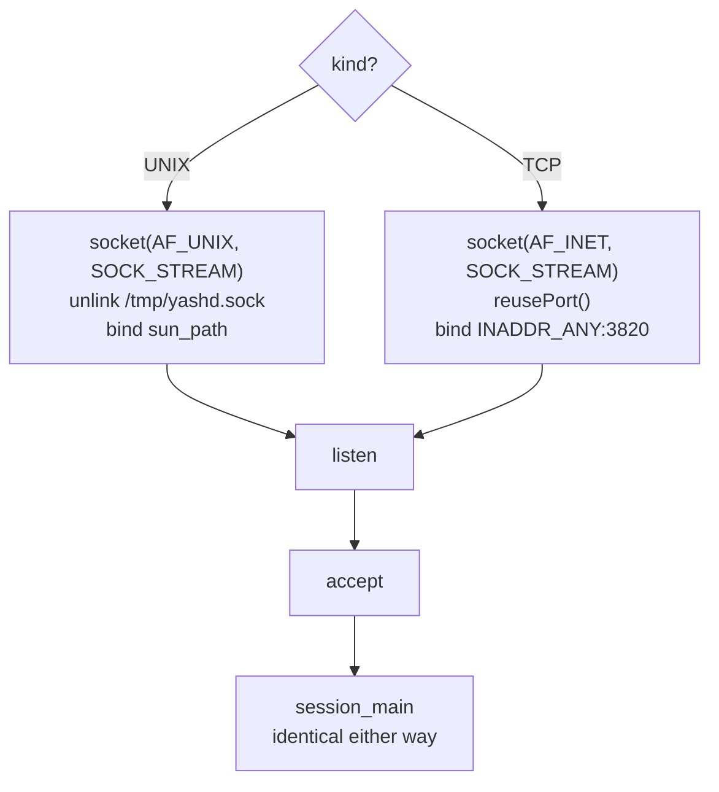

# How yashd will work

A plan, not a description of finished code. It maps every Project 1 module onto
its Project 2 replacement and calls out the three places where the port is not
mechanical.

---

## The shape of the system

```mermaid
flowchart LR
    subgraph client["yash (client)"]
        T[terminal] --> S1[select loop]
        S1 --> SOCK1[socket]
    end
    subgraph server["yashd (daemon)"]
        A[accept loop] -->|pthread_create| TH[session thread]
        TH --> P[parse]
        P --> E[exec: fork + exec]
        E --> CH[child processes]
        TH --> L[/tmp/yashd.log]
    end
    SOCK1 <-->|TCP 3820| A
    CH -->|stdout/stderr| SOCK1
```

Two programs, one protocol. The client is ~200 lines. The server is Project 1
with its three ends rewired: input comes from a socket, output goes to a
socket, and job-control signals come from messages instead of a tty.

---

## Proposed layout

```
Project 2/
  SPEC.md  PROTOCOL.md  DESIGN.md  USAGE.md
  Makefile                  builds both binaries
  yashd/
    include/  yashd.h daemon.h transport.h server.h session.h log.h
              parse.h exec.h jobs.h redirect.h builtins.h
    src/      main.c daemon.c transport.c server.c session.c log.c
              parse.c exec.c jobs.c redirect.c builtins.c
  yash/
    include/  client.h
    src/      main.c client.c
```

`parse.c` and `redirect.c` come over from Project 1 untouched — they contain no
globals and no terminal assumptions. `jobs.c`, `exec.c` and `builtins.c` need
the session-context change described below. `sig.c` does **not** come over; a
daemon has no controlling terminal, so its entire reason for existing is gone.

Build with the same pattern as Project 1 (`-std=gnu99 -Wall -Wextra -g`), plus
`-pthread` on both compile and link for the server.

---

## Transport: Unix domain first, then TCP

The professor's build order is to get it working over a **Unix domain socket**
and only then move to TCP. Both are `SOCK_STREAM`, so the difference is
confined to creating and binding the listening socket — once `accept` returns,
the connected fd behaves identically and the entire session layer is unaware of
which one it is sitting on.

That makes the toggle a three-function interface:

```c
typedef enum { TRANSPORT_UNIX, TRANSPORT_TCP } transport_kind_t;

int  transport_listen(transport_kind_t kind);          /* bound, listening fd */
int  transport_accept(int lfd, peer_t *peer);          /* fd + who connected  */
void transport_close(int lfd, transport_kind_t kind);  /* unlink the path too */
```



| | Unix domain | TCP |
|---|---|---|
| Family | `AF_UNIX` | `AF_INET` |
| Address | `/tmp/yashd.sock` in `sun_path` | `INADDR_ANY`, port `3820` |
| Stale address | `unlink()` the path before `bind` | `SO_REUSEADDR` via `reusePort` |
| Peer identity | no IP/port — see below | `inet_ntop` + `ntohs` from `accept` |
| Reach | same machine only | any machine |

**Selecting it.** The spec says the daemon runs as bare `$ yashd`, so TCP must
be the default with no arguments. The Unix domain path is opt-in:

```
$ yashd                 # TCP on 3820  (the graded mode)
$ yashd -u              # Unix domain on /tmp/yashd.sock (development)
$ yash 127.0.0.1        # TCP client
$ yash -u               # Unix domain client
```

A runtime flag beats an `#ifdef` here: one binary, and the TCP path can never
silently rot because somebody left the macro set the other way.

**The one thing that genuinely differs** is logging. The required format embeds
`<Client IP>:<Port>`, and a Unix domain peer has neither — `getpeername`
returns an empty `sun_path` for an unnamed client socket. Fill the `peer_t`
with a stand-in such as `local:<pid>` obtained from `SO_PEERCRED`, so the log
writer stays a single code path. The TCP mode, which is what gets graded,
produces the exact required format.

**Resist leaking the transport upward.** If `session_main` ever needs to know
which family it is on, the abstraction has failed. The only two places that may
know are `transport.c` and the peer-identity string.

---

## Becoming a daemon

`yashd` must detach completely before it binds anything. The canonical sequence:

| Step | Why |
|---|---|
| `fork()`, parent `_exit(0)` | The child is not a process group leader, so `setsid` can succeed. Also returns the shell prompt immediately. |
| `setsid()` | New session, new process group, **no controlling terminal**. This is what makes it a daemon. |
| `signal(SIGHUP, SIG_IGN)` + second `fork()` | The second child is not a session leader, so it can never reacquire a controlling terminal by opening a tty. |
| `chdir("/")` | Stops the daemon from pinning a filesystem that someone wants to unmount. |
| `umask(0)` | The daemon sets its own permission bits explicitly; it must not inherit the invoking shell's mask. |
| Close all inherited fds | Nothing the parent had open should leak into a long-lived process. |
| Reopen 0, 1, 2 on `/dev/null` | Any stray `printf` goes nowhere instead of writing into a random descriptor that is later reused for a socket. |
| Single-instance lock on `/tmp/yashd.pid` | Two daemons cannot share port 3820 anyway; `open(O_CREAT)` + `lockf(F_TLOCK)` makes the failure immediate and obvious. |

Reopening 0/1/2 on `/dev/null` is not cosmetic. If descriptor 1 is left closed,
the first socket the daemon opens becomes fd 1, and a stray `printf` anywhere
in the ported shell code would inject garbage into a client's stream.

Signals for the daemon process itself: ignore `SIGPIPE` (a dead client must not
kill the server), ignore `SIGTTOU`/`SIGTTIN`, and leave `SIGCHLD` at default so
`waitpid` still works per-thread.

---

## The accept loop

```c
lfd = transport_listen(kind);         /* AF_UNIX or AF_INET + reusePort */

for (;;) {
    int cfd = transport_accept(lfd, &peer);
    session_t *s = make_session(cfd, &peer);
    pthread_create(&tid, NULL, session_main, s);
    pthread_detach(tid);
}
```

For the TCP case `transport_listen` is the familiar sequence:

```c
sockfd = socket(AF_INET, SOCK_STREAM, 0);
reusePort(sockfd);                    /* SO_REUSEADDR — see below */
bind(sockfd, ... htons(3820) ...);    /* 3820 is a compile-time constant */
listen(sockfd, BACKLOG);
```

**`reusePort` / `SO_REUSEADDR`:** after a socket closes, its address sits in
`TIME_WAIT` for up to two minutes, and a fresh `bind` on 3820 fails with
`EADDRINUSE`. `SO_REUSEADDR` waives that check. Without it, restarting the
daemon during testing means waiting two minutes between runs.

**`pthread_detach`:** nothing ever joins a session thread, so detaching lets
the library reclaim its stack at exit instead of leaking one thread's worth of
memory per connection.

The client's IP and port are taken from the `struct sockaddr_in` filled by
`accept` — `inet_ntop(AF_INET, &from.sin_addr, ...)` and
`ntohs(from.sin_port)` — and stored in the session, because every log line
needs them.

---

## Change 1: global state becomes per-session state

This is the single most important difference from Project 1, and the easiest
one to get wrong.

Project 1 keeps the job table in a file-scope static:

```c
static job_t *job_list;        /* jobs.c */
pid_t shell_pgid;              /* sig.c  */
```

With one thread per client, that is a shared mutable structure with no lock —
two clients running `jobs` would see each other's processes, and concurrent
`jobs_add` calls would corrupt the list. The fix is not a mutex; it is removing
the sharing entirely:

```c
typedef struct {
    int        cfd;             /* the client socket */
    char       ip[INET_ADDRSTRLEN];
    int        port;
    job_t     *job_list;        /* was the static in jobs.c */
    int        next_jid;
    job_t     *fg_job;          /* target of CTL c / CTL z */
    int        stdin_pipe[2];   /* plain text -> running command */
} session_t;
```

Every function in `jobs.c`, `exec.c` and `builtins.c` gains a `session_t *` as
its first parameter. Mechanical, but it must be done consistently — one
leftover static is a race that only shows up with two clients connected.

Genuinely shared state is then limited to exactly two things: the listening
socket (only the accept loop touches it) and the log file.

---

## Change 2: the socket replaces the terminal — `readline` becomes `readsocket`

The whole port compresses into one substitution. Project 1's loop reads a line
from the terminal and prints to the terminal; Project 2's reads a line from the
socket and writes to the socket. Everything between those two ends — the
parser, the fork/exec, the redirection, the job table — is unchanged.

| Project 1 | Project 2 |
|---|---|
| `fgets(line, ..., stdin)` | `readsocket(session, line)` |
| `fputs("# ", stdout)` | `write(cfd, "\n# ", 3)` |
| child inherits stdout | child gets `dup2(cfd, STDOUT_FILENO)` |
| child inherits stdin | child gets `dup2(stdin_pipe[0], STDIN_FILENO)` |
| `tcsetpgrp(0, pgid)` | **deleted** — no tty to hand over |

`readsocket` is not a one-liner wrapper around `read`, and this is the part
that bites. **Stream sockets have no message boundaries.** A single `read` may
return half a line, two lines, or a line split across two packets — `fgets`
hid all of that. So the session carries a small accumulating buffer:

```c
/* appends to s->inbuf until a '\n' is present, then hands back one line */
int readsocket(session_t *s, char *line, size_t n);
```

It returns one complete `\n`-terminated line at a time, 0 on clean disconnect.
The dispatcher above it then decides whether the line is `CMD`, `CTL`, or plain
stdin text — the one genuinely new step that `fgets` had no equivalent for.

In the child, after `fork` and before `exec`:

```c
dup2(session->stdin_pipe[0], STDIN_FILENO);
dup2(cfd, STDOUT_FILENO);
dup2(cfd, STDERR_FILENO);
redirect_apply(cmd);           /* an explicit > still overrides the socket */
```

Ordering is unchanged from Project 1 and for the same reason: `redirect_apply`
runs last, so `ls > out.txt` writes to the file rather than the socket.

---

## Change 3: job control without a tty

Project 1's job control is almost entirely delegated to the kernel: the
terminal sends SIGINT and SIGTSTP to whichever process group owns it, and the
shell's only job is `tcsetpgrp`. None of that exists here. There is no
controlling terminal, so nothing delivers those signals automatically.

The server has to do explicitly what the tty used to do implicitly:

```c
case 'c': if (s->fg_job) kill(-s->fg_job->pgid, SIGINT);  break;
case 'z': if (s->fg_job) kill(-s->fg_job->pgid, SIGTSTP); break;
case 'd': close(s->stdin_pipe[1]); s->stdin_pipe[1] = -1; break;
```

Which creates a sequencing problem: while a foreground job runs, the session
thread is blocked in `waitpid`, so it cannot read the `CTL c` that is supposed
to interrupt it. Two workable answers:

1. **`select`/`poll` on the socket while waiting**, polling the child with
   `waitpid(WNOHANG)` — one thread, no extra synchronization, but a busier loop.
2. **A reader thread per session** that owns the socket and signals the job
   directly — cleaner control flow, but now two threads touch `session_t` and
   the job table needs a mutex after all.

Option 1 keeps the "one thread per client" structure the handout asks for and
keeps the session lock-free. It is the default choice unless the loop proves
unworkable.

Process groups still matter, for the same reason as Project 1: `setpgid` in
both parent and child puts a pipeline in one group so `kill(-pgid, ...)` hits
both halves at once.

---

## Logging

```
Sep 18 10:02:55 yashd[127.0.0.1:7813]: ls -l
```

Produced with `strftime("%b %e %H:%M:%S", localtime_r(&now, &tm))` — note
`localtime_r`, not `localtime`, which returns a pointer to a shared static
struct and is not thread-safe.

Only the **command** is logged, once, when it is accepted for execution — not
its output, not control messages, not malformed lines.

Every session thread writes to the same file, so the write must be atomic:

- Open `/tmp/yashd.log` once at startup with `O_WRONLY | O_CREAT | O_APPEND`.
- Format the whole line into a local buffer, then issue **one** `write`.
- Guard it with a `pthread_mutex_t` anyway. `O_APPEND` makes the offset update
  atomic, but a single mutex costs nothing here and removes any doubt.

Formatting with `printf`-style calls directly to the fd would let two threads
interleave fragments of different lines, which is exactly what the mutex and
the single-`write` discipline prevent.

---

## The client

The client is much smaller than Project 1's shell: no parser, no job table, no
`fork`, no redirection. It connects, pumps bytes in both directions, and
translates two keystrokes. It takes exactly one argument — the server's IP —
because **3820 is hardcoded** in the binary.

Its one real design problem: it must display server output *and* read the
keyboard at the same time, and both can block. `select` on the two descriptors
solves it without threads:

```c
for (;;) {
    FD_SET(STDIN_FILENO, &rfds);
    FD_SET(sockfd, &rfds);
    select(maxfd + 1, &rfds, NULL, NULL, NULL);

    if (FD_ISSET(sockfd, &rfds)) {
        n = read(sockfd, buf, sizeof buf);
        if (n <= 0) break;              /* server gone */
        write(STDOUT_FILENO, buf, n);   /* verbatim, including the prompt */
    }
    if (FD_ISSET(STDIN_FILENO, &rfds)) {
        /* at_prompt ? "CMD <line>\n" : "<line>" */
    }
}
```

Signals are translated, not handled:

| Key | Handler action |
|---|---|
| Ctrl-c | set a flag; main loop sends `CTL c\n` |
| Ctrl-z | set a flag; main loop sends `CTL z\n` |
| Ctrl-d at prompt | send `CTL d\n`, close, exit |
| Ctrl-d mid-command | send `CTL d\n` (EOF for the command's stdin) |

The handlers must be installed **without `SA_RESTART`** so `select` returns
`EINTR` and the loop notices the flag promptly — the same reasoning as
Project 1's prompt handling. The flag itself is `volatile sig_atomic_t`;
writing to the socket from inside a handler is not async-signal-safe practice
worth adopting here.

The client must not stop or die on these keys itself, so SIGINT and SIGTSTP
need real handlers rather than default dispositions.

---

## Where bugs will concentrate

| Symptom | Likely cause |
|---|---|
| Daemon dies when a client disconnects | `SIGPIPE` not ignored |
| `bind: Address already in use` on restart | `reusePort` / `SO_REUSEADDR` missing (TCP), or the stale `sun_path` not unlinked (Unix domain) |
| Commands truncated or doubled | `readsocket` assuming one `read` equals one line |
| Client hangs after a command | Server didn't send `"\n# "` on some path |
| Two clients see each other's jobs | A surviving `static` in `jobs.c` |
| Garbage mixed into a client's output | fd 0/1/2 not reopened on `/dev/null` |
| Log lines interleaved | Multiple `write` calls per entry, or no mutex |
| Ctrl-c does nothing | Thread blocked in `waitpid`, not reading the socket |
| `ls \| wc -l` hangs | Pipe fd not closed in all three places (same as Project 1) |
| Orphaned `sleep` processes | Session teardown doesn't `jobs_kill_all` |

---

## Open questions to resolve during implementation

- Does `jobs`/`fg`/`bg` output go to the socket through the same path as
  command output? (It should — the client cannot tell the difference.)
- What does `fg` mean without a terminal? Likely: `SIGCONT` the job, mark it
  foreground, and block in the `select`+`waitpid` loop so `CTL c` still reaches it.
- Should the daemon handle `SIGTERM` to shut down cleanly and remove the pid
  file? Not required, but cheap.
