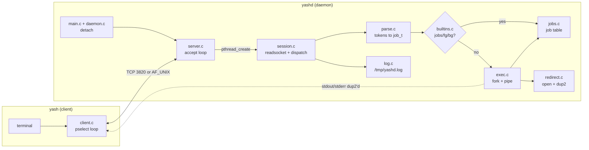
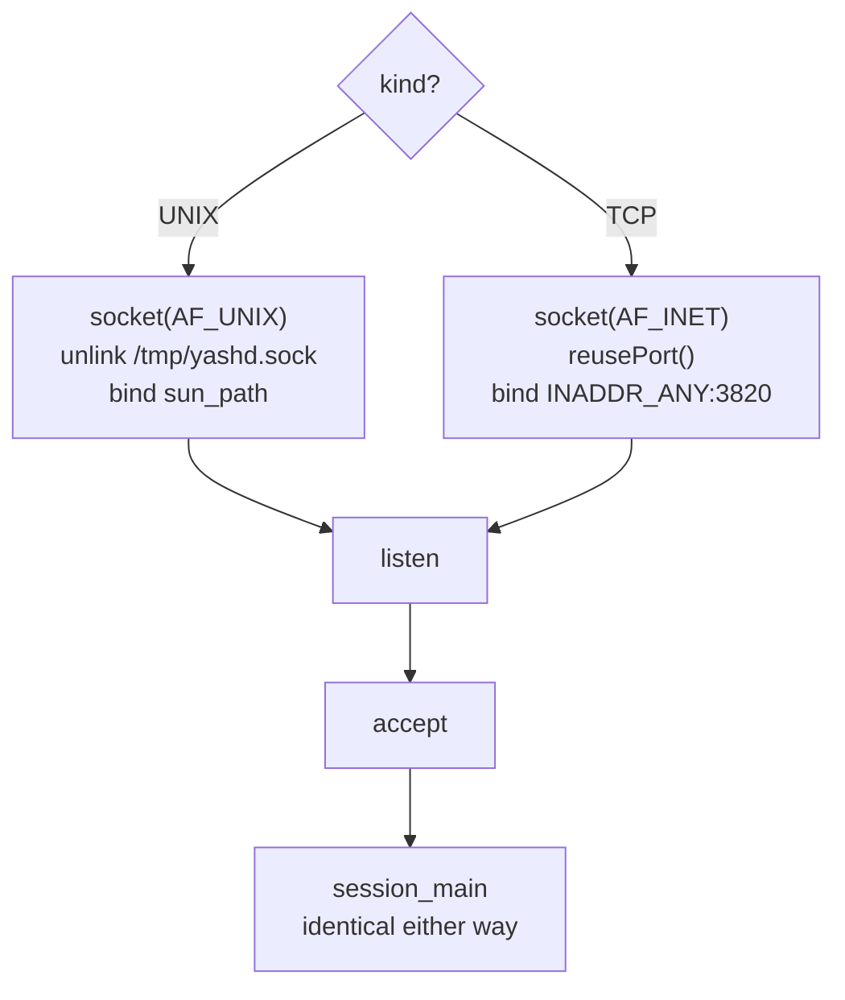
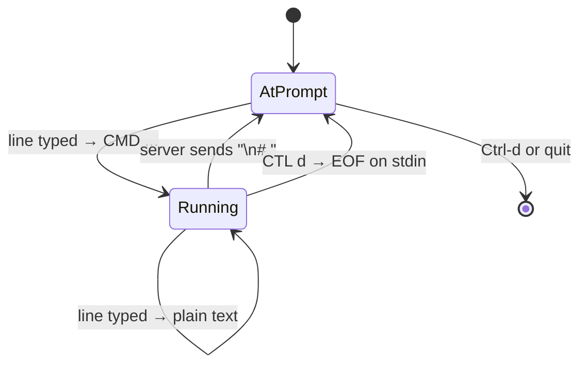

# How yashd and yash work

## Overview

Project 1 was one program that turned a line of text into processes. Project 2
splits that in half across a socket: a thin client that moves bytes, and a
daemon that runs the shell once per connected client.

```
keystroke ─► yash ─► CMD/CTL/text ─► session thread ─► parse ─► job_t ─► exec
                ◄───────────── bytes ─────────────────────────────────┘
```

The shell half is Project 1 almost verbatim. What is new is everything at the
two ends: where a line comes from, and where output goes.



Note the dotted arrow. A command's output does **not** travel back through the
daemon — the child's descriptors are the socket, so the kernel moves those
bytes directly. Only what the shell itself prints passes through `session.c`.

## The data model

Project 1's two structs survive, with one field added, and one struct is new.

A `cmd_t` is unchanged: one program plus its redirections. A `job_t` is still
everything typed on one line, plus:

```c
int infd;   /* write end of the pipe feeding this job's stdin, or -1 */
```

That exists because a command's stdin used to be the terminal, which every
process inherited for free. Now it is a pipe the session writes into when the
user types. It lives on the job rather than the session so a job stopped by
`CTL z` and resumed with `fg` still has somewhere to receive input.

A `session_t` is new, and it is the important one:

```c
int     cfd;                  /* the client socket */
peer_t  peer;                 /* IP and port, for the log line */
job_t  *job_list;             /* was a file-scope static in Project 1 */
job_t  *fg_job;               /* target of CTL c / CTL z */
char    inbuf[YASH_BUF_SIZE]; /* partial line held across reads */
size_t  inlen;
int     quit;
```

Everything Project 1 kept in globals lives here instead. With one thread per
client, a `static job_t *job_list` would be shared mutable state: two clients
would see each other's jobs and concurrent `jobs_add` calls would corrupt the
list. The fix is not a mutex, it is removing the sharing — so every function in
`jobs.c`, `exec.c` and `builtins.c` takes a `session_t *` as its first argument.

Genuinely shared state is down to two things: the listening socket, which only
the accept loop touches, and the log file, which has a mutex.

## main.c and daemon.c — detaching

`yashd` must become a daemon before it binds anything.

| Step | Why |
|---|---|
| `fork()`, parent `_exit(0)` | The child is not a process group leader, so `setsid` can succeed. |
| `setsid()` | New session, new group, **no controlling terminal**. This is what makes it a daemon. |
| ignore `SIGHUP`, `fork()` again | The grandchild is not a session leader, so opening a tty can never reacquire one. |
| `chdir("/tmp")` | Stops the daemon pinning the invoking user's directory. `/tmp` rather than `/` so a client's `echo hi > out.txt` still lands somewhere writable. |
| `umask(0)` | Permission bits are set explicitly, not inherited from whoever launched it. |
| close every inherited fd | Nothing the parent had open leaks into a long-lived process. |
| reopen 0, 1, 2 on `/dev/null` | See below. |
| `lockf` on `/tmp/yashd.pid` | Two daemons cannot share port 3820; the lock makes the second one fail immediately. |

Reopening the standard three is not cosmetic. Left closed, the first socket the
daemon opens becomes descriptor 1, and any stray `printf` in the ported shell
code would be injected straight into some client's output stream.

`main` also ignores `SIGPIPE` process-wide. A client that disappears mid-write
would otherwise kill the whole daemon, every other session included.

The pid-file lock is taken *after* both forks, because record locks are not
inherited across `fork` — taking it earlier would leave the daemon unlocked.

## transport.c — one socket, two families

The professor's build order was Unix domain socket first, then TCP. Both are
`SOCK_STREAM`, so once `accept` returns, nothing above it can tell the
difference. That makes the toggle a three-function interface:

```c
int  transport_listen(transport_kind_t kind);
int  transport_accept(int lfd, transport_kind_t kind, peer_t *peer);
void transport_close(int lfd, transport_kind_t kind);
```



`yashd` alone is TCP, because the spec requires bare `$ yashd` to work;
`yashd -u` selects the Unix domain path, and `yash -u` matches it.

**`reusePort` is `SO_REUSEADDR`.** After a socket closes its address sits in
`TIME_WAIT` for up to two minutes, so a restart fails with `EADDRINUSE`. The
Unix domain equivalent is `unlink`ing a stale socket node before `bind`.

The one place the transport leaks upward is peer identity. The log format wants
`<IP>:<Port>`, and an `AF_UNIX` client has neither, so `peer_from_unix` fills
in `local:<pid>` from `SO_PEERCRED`. That keeps `log_command` a single code
path; the graded TCP mode produces the exact required format.

## server.c — the accept loop

```c
lfd = transport_listen(kind);
for (;;) {
    cfd = transport_accept(lfd, kind, &peer);
    s   = session_create(cfd, &peer);
    pthread_create(&tid, NULL, session_main, s);
    pthread_detach(tid);
}
```

Nothing ever joins a session thread, so `pthread_detach` is what reclaims its
stack when the client leaves. Without it the daemon leaks one thread's worth of
memory per connection, which matters for a process that is meant to run
forever.

`EINTR` and `ECONNABORTED` from `accept` are retried rather than treated as
fatal — neither means the listening socket is broken.

## session.c — the read loop, and the real deviation

This is where Project 1's `main.c` went, and where the port stops being
mechanical. The loop has the same shape:

```c
for (;;) {
    jobs_reap(s);                            /* Done lines, before the prompt */
    session_prompt(s);                       /* "\n# " to the socket */
    if (session_readsocket(s, line, n) <= 0) break;
    dispatch(s, line);
    if (s->quit) break;
}
session_destroy(s);
```

Three things changed, and each one is a class of bug.

**`fgets` becomes `session_readsocket`.** A stream socket has no message
boundaries. One `read` can return half a line, two lines, or a line split
across packets — all of which `fgets` hid. So `buf_fill` appends to `s->inbuf`
and `buf_take_line` pops one `\n`-terminated line at a time, leaving the
remainder buffered for next time.

**A line is a typed message, not automatically a command.** This step has no
Project 1 equivalent at all:

| Prefix | Handler |
|---|---|
| `CMD ` | `handle_cmd` — parse, log, builtin or exec |
| `CTL ` | `handle_ctl` — signal the foreground job |
| anything else | `handle_text` — write it to `fg_job->infd` |

**Output no longer goes to stdout, and it splits in two.** A command's own
output bypasses the daemon entirely via `dup2`. But everything the *shell*
prints — job lines, `Done` messages, the line `fg` echoes — was `printf` in
Project 1, and the daemon's stdout is `/dev/null`. Every one of those became
`session_printf`. Miss one and it vanishes silently while ordinary command
output keeps working, which makes it genuinely hard to spot.

There are two dispatchers, and the distinction matters:

| | `dispatch` | `dispatch_running` |
|---|---|---|
| Used by | the main loop, at the prompt | `session_pump`, while a job runs |
| `CMD` | runs the command | treated as stdin |
| `CTL` | signals / ends the session | signals the job |
| plain text | ignored | stdin for the job |

Routing `CMD` to `handle_cmd` from inside the pump would fork a second job on
top of the running one, since the pump is called from `jobs_wait_fg`. Treating
it as stdin is both safer and what the protocol actually specifies.

`session_pump` is how the socket stays responsive while a command runs: it
drains any buffered lines, then `select`s on the socket with a 50 ms timeout so
its caller can poll the job in between.

## exec.c — creating processes

The fork/exec skeleton is Project 1's. The child's descriptor setup is not:

```c
if (i == 0) dup2(inpipe[0], STDIN_FILENO);   /* the client's typed text */
dup2(s->cfd, STDOUT_FILENO);
dup2(s->cfd, STDERR_FILENO);
/* ... then the pipe dup2s, which override the socket on the piped side ... */
redirect_apply(cmd);                          /* last, so `> file` beats both */
```

The ordering is unchanged and for the same reason: whatever runs last owns the
descriptor, so an explicit redirection beats the pipe, which beats the socket.
The child then closes its own copy of `s->cfd`; the three dups keep the
connection alive for as long as it runs.

`reset_child_signals` restores `SIG_DFL` before `exec`. Project 1 needed this
for `SIGTTIN`/`SIGTTOU`; here it matters more, because the daemon ignores
`SIGPIPE` and `SIGHUP` and `SIG_IGN` survives `exec`. A command inheriting an
ignored `SIGPIPE` misbehaves inside a pipeline.

Background jobs get `infd` closed immediately, so they read EOF instead of
stealing what the user types next.

Everything else carries over: both parent and child call `setpgid` to close the
fork race, the pipe descriptors are closed in all three places so the reader
sees EOF, and `execvp` searches `PATH` with the inherited environment.

## jobs.c — the job table without a terminal

Two changes from Project 1, one obvious and one not.

**The obvious one:** the list hangs off `session_t`.

**The one that bites:** Project 1 could call `waitpid(-1, ...)` — "any child" —
because the shell was the only thing running. Child processes belong to the
*process*, not the thread that forked them, so in a threaded daemon that lets
one session reap another session's child. The status is then handed to a thread
that doesn't recognize the pid and is discarded: the owning client's job sits in
`Running` forever and never prints `Done`. Both wait paths therefore wait on the
job's own process group, never on `-1`.

The foreground wait is the other place losing the terminal changes the
algorithm. Project 1 blocked in `waitpid` and let the tty deliver SIGINT and
SIGTSTP. Here the interrupt arrives as a `CTL` message on the socket, so
blocking in `waitpid` would make the job uninterruptible:

```c
while (job->nlive > 0) {
    if (!s->quit) {
        if (session_pump(s, FG_POLL_MS) == 0) {   /* client vanished */
            s->quit = 1;
            kill(-job->pgid, SIGKILL);
        }
        if (poll_job(job, 0)) return;             /* stopped, not finished */
    } else if (poll_job(job, 1)) {
        return;
    }
}
```

Once the client is gone nothing can interrupt the job any more, so the loop
switches to a blocking wait rather than spinning.

| | `jobs_wait_fg` | `jobs_reap` |
|---|---|---|
| Blocks? | no — alternates pump and poll | no (`WNOHANG`) |
| Waits on | `-job->pgid` | each job's own `-pgid` |
| Used for | foreground jobs, `fg` | background jobs, `Done` lines |

`jobs_kill_all` runs on session teardown and `SIGKILL`s every group, then reaps
them. `SIGKILL` cannot be caught and reaches stopped processes without a
preceding `SIGCONT`, so no child outlives its client.

## builtins.c, parse.c, redirect.c, log.c

`parse.c` and `redirect.c` came over **unchanged**. They touch no globals, make
no assumptions about a terminal, and — in `redirect.c`'s case — benefit from
running in a child whose stderr is already the socket, so `perror` reaches the
client for free.

`builtins.c` is Project 1's with two edits: `printf` became `session_printf`,
and `fg` no longer calls `tcsetpgrp`. There is no terminal to hand over, so
`fg` means "`SIGCONT` the group, mark it foreground, and run the same wait loop
so `CTL c` still reaches it".

`log.c` writes the required syslog-like line:

```
Sep 18 10:02:55 yashd[127.0.0.1:7813]: ls -l
```

Two details. `localtime_r`, not `localtime`, which returns a shared static
struct and is not thread-safe. And the entry is formatted whole into a local
buffer and emitted with a **single** `write` under a mutex — a sequence of
`printf`-style calls would let two threads interleave fragments of different
entries.

## The client — yash/src/client.c

The client has no shell logic at all: no parser, no `fork`, no job table. It
connects, pumps bytes, and translates two keystrokes.

Its one design problem is that it must display server output *and* read the
keyboard, and either can block. One `pselect` over both descriptors solves it
without threads. Server bytes are written to stdout verbatim, prompt included —
the client never parses them and never prints a prompt of its own.

**`pselect`, not `select`.** A signal arriving between the flag check and the
wait would set the flag and then leave the client blocked until some unrelated
input arrived, so Ctrl-c would appear to do nothing until the next keystroke.
Blocking SIGINT and SIGTSTP outside the call and letting `pselect` unblock them
atomically inside closes that window.

**Catching SIGTSTP is what keeps the client alive.** The default action would
suspend the client; the keystroke belongs to the command on the server.

**The `prompt` flag has two inputs, not one.** It is set when received bytes end
with `"\n# "`, and cleared the moment a `CMD` is sent:



Tracking only the receive half looks correct and even passes a casual test,
because the first command really was typed at a prompt. But the server sends no
prompt while a command runs, so the stale flag turns every following line into
another `CMD` — `cat > file.txt` then receives its input as commands, and the
Ctrl-d meant for `cat` ends the session instead.

Ctrl-d is deliberately overloaded and that same flag disambiguates it: at the
prompt it ends the session, mid-command it is EOF for the command's stdin.
There is one wrinkle — on a terminal, `read` returning 0 is not sticky and the
next read works fine, but on a pipe it is, so the client drops stdin from the
`pselect` set only when stdin is not a tty. Otherwise it would spin re-reading
EOF forever.

## Why the modules are split this way

Each file owns one failure mode, so a symptom maps to a file:

| Symptom | Look in |
|---|---|
| Daemon dies when a client disconnects | `main.c` — `SIGPIPE` |
| `bind: Address already in use` | `transport.c` — `reusePort`, stale `sun_path` |
| Garbage mixed into a client's output | `daemon.c` — fds 0/1/2 |
| Commands truncated, doubled, or split | `session.c` — `buf_take_line` |
| Job lines vanish but command output works | a `printf` that should be `session_printf` |
| Two clients see each other's jobs | a surviving `static` in `jobs.c` |
| A `Done` line never appears | `jobs.c` — a `waitpid(-1, ...)` |
| Ctrl-c does nothing | `jobs_wait_fg` blocking instead of pumping |
| Typed input runs as commands | `client.c` — `prompt` not cleared on send |
| Pipeline hangs | `exec.c` — a pipe fd not closed in all three places |
| Log lines interleaved | `log.c` — more than one `write` per entry |

As in Project 1, every `waitpid` lives in one file. The new rule is that every
signal *disposition* now lives in two well-defined places instead of a `sig.c`:
the daemon's own in `main.c`, the child's in `exec.c`.

## What changed from Project 1

| Project 1 | Project 2 |
|---|---|
| `fgets(line, ..., stdin)` | `session_readsocket(s, line, n)` |
| every line is a command | `CMD` / `CTL` / plain text, via `dispatch` |
| `fputs("# ", stdout)` | `session_prompt(s)` sends `"\n# "` |
| `printf` for job lines | `session_printf(s, ...)` |
| child inherits stdout | `dup2(s->cfd, STDOUT_FILENO)` |
| child inherits the terminal's stdin | `dup2(job->infd pipe, STDIN_FILENO)` |
| tty delivers SIGINT/SIGTSTP | `kill(-pgid, ...)` on a `CTL` message |
| `tcsetpgrp` hands over the terminal | deleted — there is no terminal |
| `waitpid(-1, ...)` | `waitpid(-job->pgid, ...)` |
| globals in `jobs.c` and `sig.c` | fields of `session_t` |
| one process | one detached pthread per client |

`parse.c` and `redirect.c` are the only files that crossed over untouched,
which is a reasonable measure of how well Project 1's module boundaries held up.
