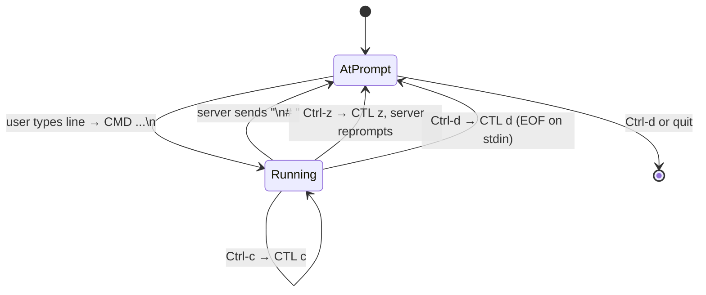

# The yash protocol

The protocol exists so any client can drive any server. It is deliberately
tiny: three message types going out, raw bytes coming back.

It is also **transport-independent**. The messages below are identical whether
they travel over a Unix domain socket or TCP on port 3820 — both are
`SOCK_STREAM`, and nothing in the protocol refers to addresses. That is what
makes the professor's "Unix domain first, then TCP" build order free: the
protocol layer is written once and never revisited when the transport changes.

---

## Wire format

### Client → server

| Form | Meaning |
|---|---|
| `CMD <string>\n` | Run `<string>` as a shell line |
| `CTL <c\|z\|d>\n` | Deliver a control character to the running command |
| anything else | Plain text — stdin for the running command |

The keyword is three uppercase letters followed by exactly one blank. Every
message ends with `\n`.

```
CMD ls -l\n
CMD ps -ef | more\n
CTL c\n
CTL z\n
CTL d\n
```

### Server → client

Plain ASCII text. Nothing else. The text is whatever the command wrote to
stdout and stderr, plus the prompt.

---

## The prompt is the frame delimiter

Stream sockets are an undelimited byte stream, so the client needs some way to
know the server is finished. The handout's answer is to reuse the prompt:

```
"\n# "
```

The `#` the user sees is **generated by the server**, not the client. The
client never prints a prompt of its own — it writes whatever arrives, verbatim,
and does no parsing at all. When the user sees `#` on its own line, the server
is idle and ready for the next command. The leading `\n` is what guarantees
that — without it, a command whose output lacks a trailing newline
(`printf hello`) would produce `hello# `.

This also means the server must send a prompt after **every** completed
command, including ones that produced no output and ones that failed.

---

## Who decides CMD vs. plain text

Only the client, and it uses one bit of state:

```
at_prompt = 1   after the last byte received ended with "# "
at_prompt = 0   after sending a CMD, until the prompt comes back
```

- `at_prompt == 1` → the user is typing a shell line → send `CMD <line>\n`
- `at_prompt == 0` → a command is running → send the line verbatim as plain text

That is the whole rule. `cat > file.txt` works because the `CMD` line flips the
bit, every subsequent line is forwarded raw, and Ctrl-d sends `CTL d` which
closes the child's stdin.



Ctrl-d is overloaded on purpose and the state bit disambiguates it: at the
prompt it ends the session, inside a running command it is EOF on that
command's stdin.

---

## Control message semantics

| Message | Server action |
|---|---|
| `CTL c` | `kill(-fg_pgid, SIGINT)` — kill the foreground job, not the session |
| `CTL z` | `kill(-fg_pgid, SIGTSTP)` — stop it; it becomes a stopped job |
| `CTL d` | Close the write end of the pipe feeding the child's stdin |

If no foreground job exists, `CTL c` and `CTL z` are no-ops. The server must
still send a prompt afterward so the client doesn't hang waiting for one.

Note the sign: `-pgid` signals the whole process group, so both halves of a
pipeline stop together — same mechanism as Project 1, just triggered by a
message instead of the tty.

---

## Worked examples

### A simple command

```
client → CMD ls -l\n
server → total 8\ndrwxr-xr-x ...\n
server → \n#
```

### Interactive stdin

```
client → CMD cat > out.txt\n
client → hello\n
client → world\n
client → CTL d\n
server → \n#
```

### Interrupting

```
client → CMD sleep 100\n
         (user presses Ctrl-c)
client → CTL c\n
server → \n#
```

### Background job

```
client → CMD sleep 30 &\n
server → \n#
client → CMD jobs\n
server → [1] + Running   sleep 30 &\n
server → \n#
```

---

## Edge cases to get right

- **A `CMD` line with an empty or malformed command** still gets a prompt back.
  Project 1 silently ignores bad lines; keep that, but send the prompt.
- **Output larger than one `read`.** The server writes incrementally as the
  child produces output; the client must loop on `read` and not assume one
  message per packet.
- **A message split across two `read` calls.** The reverse of the above, and
  the more common bug. The server's `readsocket` must accumulate bytes until it
  has a full `\n`-terminated line — `CMD ls -` and `l\n` can arrive separately.
- **The client dies mid-command.** The server's `read` returns 0; the thread
  must kill all jobs in that session and clean up, not leak processes.
- **`SIGPIPE`.** Writing to a socket whose peer is gone kills the daemon by
  default. Ignore `SIGPIPE` process-wide and handle `EPIPE` from `write`.
- **Interleaving.** One session is one thread with one socket; the thread must
  not have two writers racing on the same fd.
